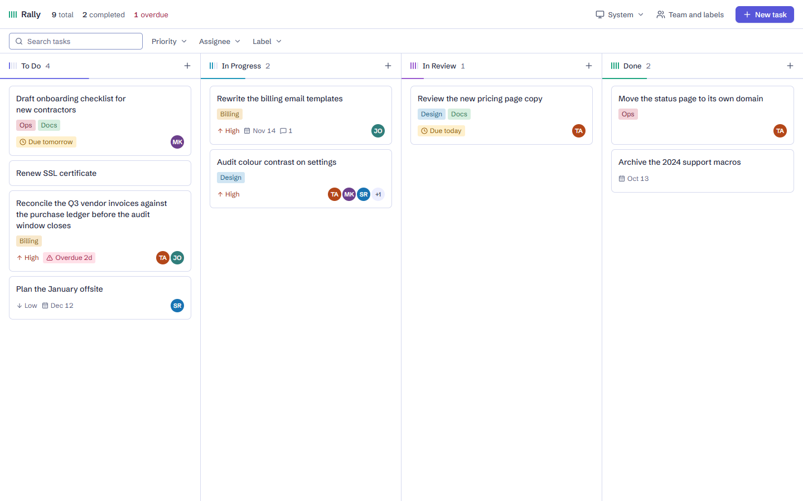
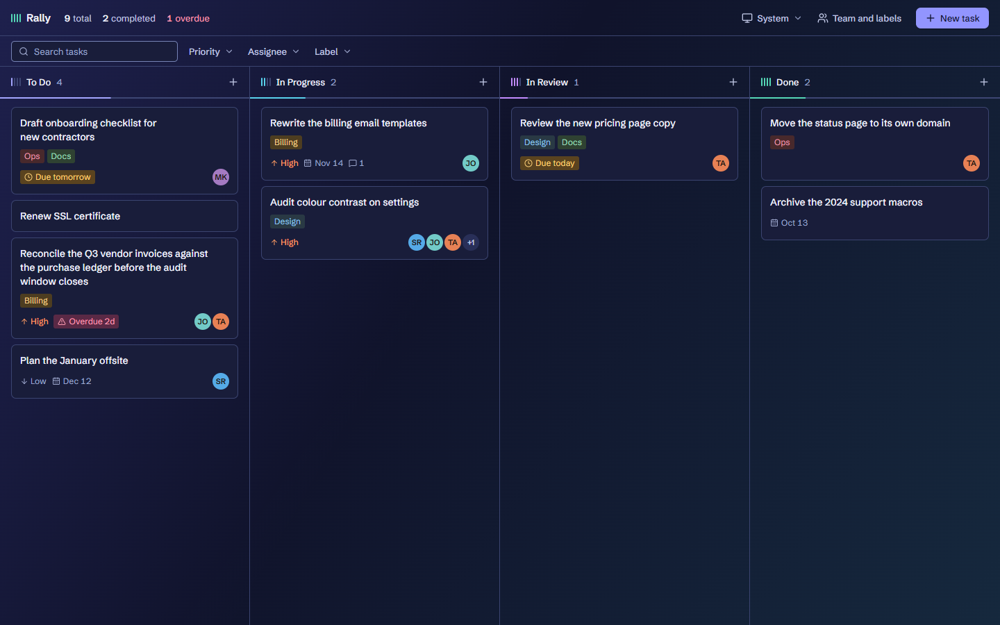
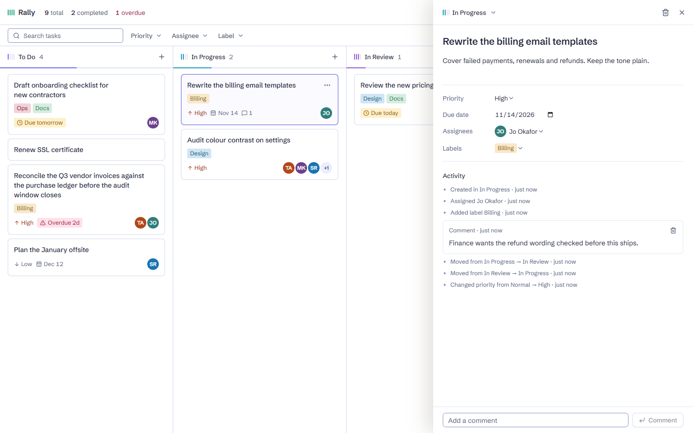
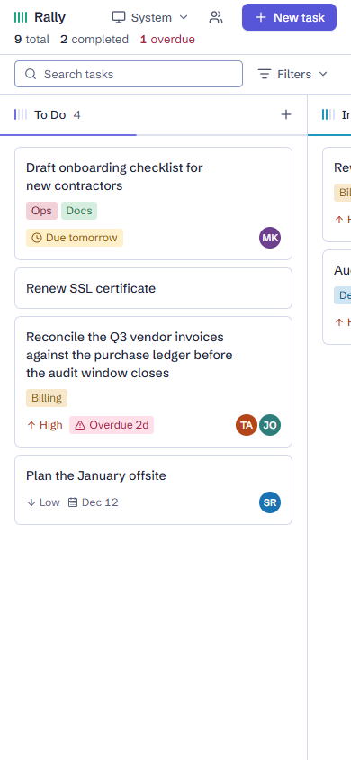

# Rally

Rally is a Kanban task board for keeping track of work as it moves from To Do to Done. There is nothing to sign up for: each visitor gets a private board through an anonymous session created on first launch, and only that visitor can see or change it.



| Dark mode | Task panel | Phone |
|---|---|---|
|  |  |  |

## Features

**The board**

- Four lanes: To Do, In Progress, In Review and Done
- Drag and drop between and within lanes, by mouse, touch or keyboard, with the order saved
- Changes appear instantly and roll back with a message if saving fails
- Live sync across open tabs and devices
- A count and load bar on each lane, showing where the work is piling up
- A **Load sample board** button on an empty board, to see everything in use with one click

**Tasks**

- Title, description, priority and due date
- Due soon and overdue indicators on cards
- A detail panel for editing every field
- Comments, in time order, mixed with the task's history
- An activity timeline written by the database, such as "Moved from To Do → In Progress · 2 hours ago"

**Team and labels**

- Team members with a name and colour, shown as avatars on cards
- More than one assignee per task
- Custom coloured labels, more than one per task

**Finding work**

- Search by title
- Filters for priority, assignee and label, which can be combined
- Board stats for total, completed and overdue tasks

**Everywhere**

- Light, dark and system themes
- Responsive layout down to phones, with a drop tray for moving cards between lanes
- Keyboard and screen reader support

**Privacy**

- Row Level Security on every table, so guests can only reach their own data
- Only the Supabase publishable key is used, in both browser and server code

## Tech stack

| Area | Tools |
|---|---|
| Framework | Next.js (App Router), React, TypeScript |
| Backend | Supabase: Postgres, anonymous Auth, Row Level Security, Realtime |
| Data | TanStack Query for reads and optimistic updates, server actions for writes |
| Drag and drop | `@dnd-kit` |
| Styling | Plain CSS with design tokens and CSS Modules, `lucide-react` icons, self-hosted Schibsted Grotesk |
| Testing | Vitest, pgTAP, Playwright, axe |

## Setup

### What you need

- Node.js 24
- Docker, running, for the local Supabase stack

### Run it locally

```sh
npm install
npx supabase start
cp .env.example .env.local
npx supabase status -o env
```

The last command prints your local keys. Put them in `.env.local`:

| From `supabase status` | In `.env.local` |
|---|---|
| `API_URL` | `NEXT_PUBLIC_SUPABASE_URL` |
| `PUBLISHABLE_KEY` | `NEXT_PUBLIC_SUPABASE_PUBLISHABLE_KEY` |

Then start the app and open http://127.0.0.1:3000:

```sh
npm run dev
```

To rebuild the local database from scratch, run `npx supabase db reset`. To stop the stack, run `npx supabase stop`.

### Deploy it

1. Create a Supabase project, and turn on anonymous sign-ins under **Authentication > Sign In / Providers**.
2. Link the project and create the tables. Guests start with an empty board and can load the sample board themselves.

   ```sh
   npx supabase link --project-ref <your-project-ref>
   npx supabase db push
   ```

3. Deploy to a host that runs Next.js on a server, such as Vercel, because writes use server actions. Set `NEXT_PUBLIC_SUPABASE_URL` and `NEXT_PUBLIC_SUPABASE_PUBLISHABLE_KEY` from **Project Settings > API**.

Never use the service role key in this app. It bypasses Row Level Security.

## Tests

| Command | What it runs |
|---|---|
| `npm test` | Unit tests for board logic |
| `npm run test:db` | Database tests: security rules, privileges, triggers and constraints |
| `npm run test:api` | Two real anonymous sessions over Auth, the API and Realtime. Local only |
| `npm run test:e2e` | Browser tests, including an axe accessibility scan of each screen in both themes |
| `npm run typecheck` | TypeScript |
| `npm run build` | Production build |

### What is tested

**Unit tests** (`src/lib/board/`)

- Card positions, including when the gap between two cards runs out and a lane has to be renumbered
- Grouping tasks into lanes and moving cards between them
- Due dates: due soon, overdue, finished work never flagged, and how dates are worded
- Search and filters, on their own and combined
- Board stats and avatar initials
- The wording of every kind of activity entry

**Database tests** (`supabase/tests/`)

- Row Level Security is on for every table, and the anon role can't reach any of them
- One guest can't read, change, delete or impersonate another guest's rows, or link to them
- Columns that shouldn't change, such as the owner and timestamps, can't be written
- History can't be forged or erased, even by the task's owner
- Every activity kind is logged, and reordering isn't
- Automatic positions, `updated_at` and check constraints
- Deleting an account removes all of its data

**API isolation test** (`supabase/tests/api_isolation.mjs`)

- Two real anonymous sessions can't read or change each other's data through the API
- Realtime delivers a guest's own changes, and doesn't send another guest's inserts or updates
- A Realtime client without a filter sees only the primary key of another guest's deleted row, a known limit

**Browser tests** (`e2e/`)

- First launch: one anonymous session, kept across reloads, with the empty state shown
- Creating, editing and deleting tasks, with validation and loading states, and everything still there after a reload
- Drag and drop by mouse, keyboard and emulated touch, including the phone tray
- Team members, labels and assignees
- Comments and the activity timeline
- Search, filters, stats, and due soon and overdue indicators
- Realtime sync between two tabs
- Two guests in separate browsers, including one calling a server action on the other's task
- Failed saves rolling back with a message, and the failure screen with retry
- Saved themes applying without a flash, and fonts served from the app's own origin
- Worst-case data: very long titles, many labels and assignees, emoji and non-Latin text
- Keyboard focus, screen reader announcements and touch target sizes
- Loading the sample board, including its failure and loading states
- An axe accessibility scan of each main screen in both themes, including all ten label colours

Not covered: real phones, Firefox, Safari, and testing with an actual screen reader.

### Running the browser tests

If port 3000 is busy, set `E2E_PORT` to run the browser tests on another port.

## Project structure

```text
src/
├── app/                # Routes. "/" redirects to the board in (dashboard)/board
├── actions/            # Server actions: every write
├── components/
│   ├── ui/             # Shared primitives, one folder per component
│   └── features/       # Board, panel, dialogs and screens, one folder per component
├── lib/
│   ├── auth/           # Anonymous session
│   ├── board/          # Pure board logic and its unit tests
│   ├── data/           # Queries, optimistic writes and Realtime sync
│   ├── supabase/       # Browser client, server client and session proxy
│   └── ui/             # Theme, toasts and small UI hooks
├── styles/             # Design tokens and base styles
└── types/              # TypeScript definitions
supabase/
├── migrations/         # Tables, indexes, triggers, privileges, policies, realtime
└── tests/              # Database tests and the API isolation test
e2e/                    # Browser tests
```

Further reading: [`design/DESIGN.md`](design/DESIGN.md) is the design system, and [`supabase/migrations/`](supabase/migrations/) defines the database and how guests are kept apart.
